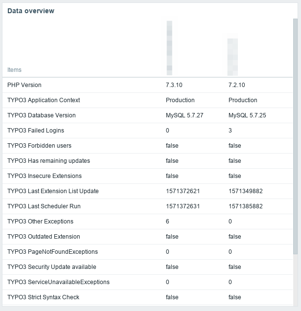
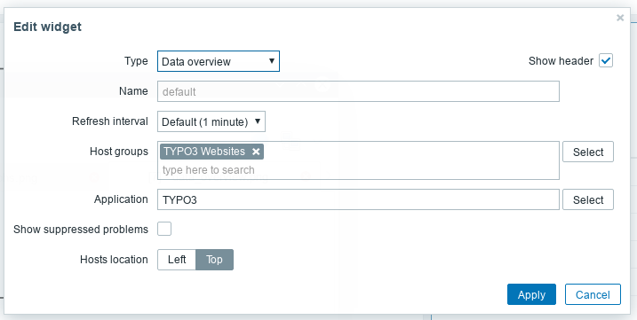

.. include:: ../Includes.txt

.. _installation:

============
Installation
============

.. _server:

Zabbix setup
============

.. rst-class:: bignums-xxl

1. Import

    Download the template for Zabbix 7.x from GitHub and import it under
    :guilabel:`Data collection > Templates > Import`:

    *   `typo3.yaml (view) <https://github.com/WapplerSystems/zabbix_client/blob/release/v14/Resources/Private/ZabbixTemplate/zabbix-7/typo3.yaml>`__
    *   `typo3.yaml (download) <https://raw.githubusercontent.com/WapplerSystems/zabbix_client/release/v14/Resources/Private/ZabbixTemplate/zabbix-7/typo3.yaml>`__

    The file is also shipped with the extension in
    ``Resources/Private/ZabbixTemplate/zabbix-7/typo3.yaml``. It contains
    :guilabel:`Template TYPO3 9-14`, its parent template
    :guilabel:`Template Frontend Performance` and that one's parent
    :guilabel:`Monitoring Defaults`; the second parent, :guilabel:`HTTP Service`,
    is part of every Zabbix installation. The template is exported from a production
    Zabbix, so it always matches the operations of the current release. Re-importing a
    newer version updates the existing template, hosts and history are kept.

    Check intervals are user macros. :guilabel:`Monitoring Defaults` sets conservative
    values (``{$TYPO3.DELAY.FAST}`` 30m, ``{$TYPO3.DELAY.HOURLY}`` 6h,
    ``{$FRONTEND.DELAY}`` 15m, ``{$TYPO3.NODATA}`` 7200s). For hosts you want to watch
    closely, override them on the host or in a template linked directly to the host,
    e.g. 5m, 1h, 1m and 1000s plus ``{$FRONTEND.WINDOW}`` 5m and
    ``{$TYPO3.OPCACHE.WINDOW}`` 30m.

    The files in ``zabbix-5/`` and ``zabbix-6/`` are kept for older Zabbix versions but no
    longer maintained.

    .. figure:: ../Images/template_import.png
        :alt: Import template

2. Create a host and add this template

    .. figure:: ../Images/template_add.png
        :alt: Add the template

    .. figure:: ../Images/template_add2.png
        :alt: Add the template

    Important: You have to enter a DNS name / Domain / Subdomain (and set "Connect to" to DNS) or a IP address at "Agent interfaces".

3. Macros

    Add two macros to the host:

    ``{$TYPO3_CLIENT_KEY}``
        A long user-defined key. The same value goes into the extension settings.

    ``{$TYPO3_CLIENT_PATH}``
        The URL of the endpoint, e.g. ``https://www.example.com/zabbixclient/``.

    Optional macros of the frontend check: ``{$FRONTEND.SCHEME}`` (``https``),
    ``{$FRONTEND.PATH}`` (``/``), ``{$FRONTEND.RESP.WARN}`` and ``{$FRONTEND.RESP.HIGH}``
    (response time thresholds in seconds, ``2`` and ``5``).

    .. figure:: ../Images/host_macros.png
        :alt: Host macro

.. _client:

Client setup
============

.. rst-class:: bignums-xxl

1. Install the extension

2. Extension setup

    Set a key in the extension settings. The key is mandatory: as long as no key is
    configured, the endpoint answers every request with HTTP 403. Use the same value as
    the ``{$TYPO3_CLIENT_KEY}`` macro in Zabbix.

    Optionally restrict "Allowed IPs" to the address of your Zabbix server or proxy.

    .. figure:: ../Images/typo3_ext.png
        :alt: Extension setting

3. Finished

    Everything necessary is now done. Zabbix can now be configured further.

.. _further-setup:

Further Zabbix setup
====================

Now you can add graphs and data overviews to your dashboard

Data overview
-------------

